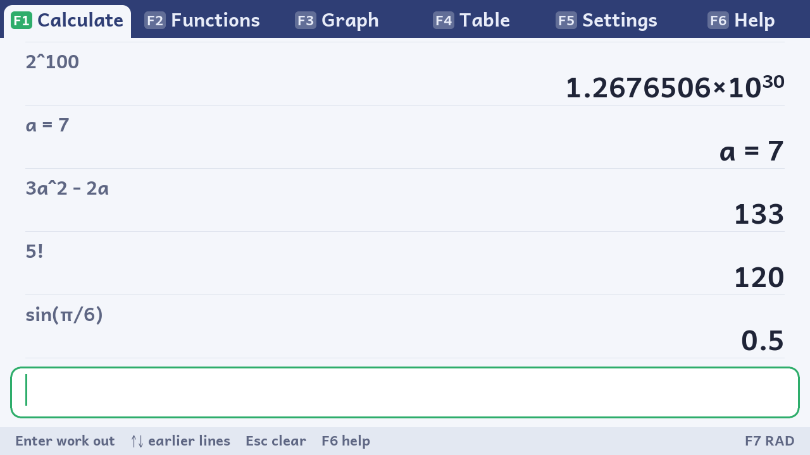
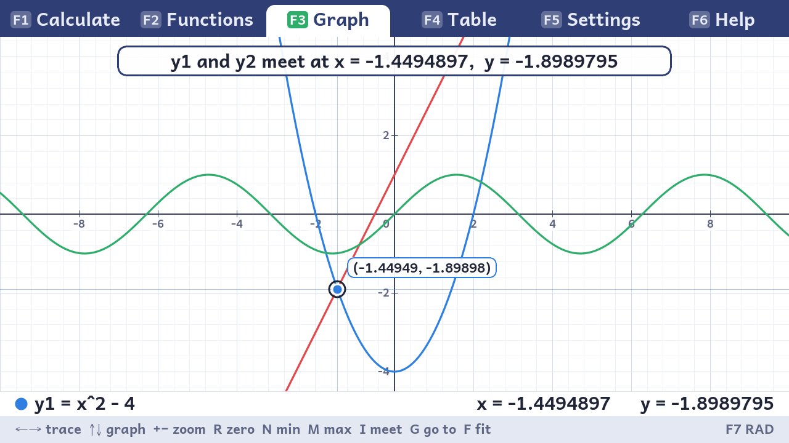
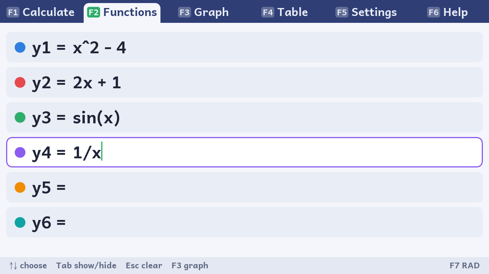
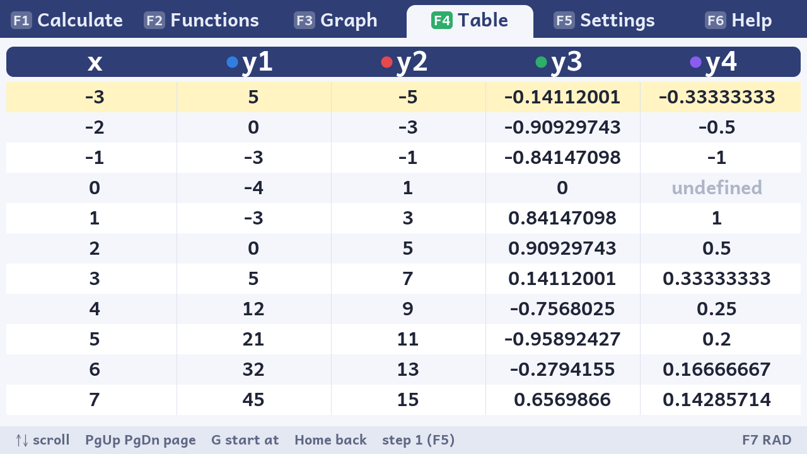

# Graphing Calculator

A graphing calculator for high-school maths that runs directly on a
**Raspberry Pi 3 B+** with **no operating system**, in the same way as
[Typing Adventure](https://github.com/meelash/pi-typing). It works on its own
card, or as one of the programs on a [pi-launcher](https://github.com/meelash/pi-launcher)
boot menu card.

| Calculate | Graph: where two graphs meet |
|---|---|
|  |  |
| **Functions** | **Table** |
|  |  |

## What it does

- **Calculate** with the maths students write: `2x^2 - 3x + 1`, `3(x+1)`,
  `|x - 2|`, `5!`, `sin(30)`, `log(8, 2)`, `root(27, 3)`, `(-8)^(1/3)`,
  `ncr(52, 5)`, `pi`, `e`, `ans`. Letters keep values (`a = 7`).
  Errors are explained in plain words ("A ) is missing") with the cursor on
  the problem.
- **Six functions** `y1` to `y6`, each in its own colour. They can use letters
  (`a*x^2`) and each other (`y2 = 2y1 + 1`).
- **Graph** with trace, zoom, pan, fit, square window, and analysis: zeros,
  minimums, maximums and where two graphs meet. Breaks such as `1/x` at 0 or
  `tan` at 90° are not joined up.
- **Table** of values from any start and step.
- **Degrees or radians** (F7). `sin(180)` in degrees and `sin(pi)` in radians
  are exactly 0; `tan(45)` is exactly 1.
- Functions, settings, letters and the last 20 calculations are **kept on the
  SD card** (`graphcalc/state.txt`, plain text), saved a few seconds after each
  change.

## Maths without a C library

There is no operating system, so there is no `libm` either.
[`src/core/mathlib.cpp`](src/core/mathlib.cpp) implements `exp`, `ln`,
`sin`/`cos`/`tan` (Cody-Waite reduction), `atan`, powers (including real odd
roots of negative numbers), `cbrt` and `gamma` in double precision.
[`tests/math/mathtest.cpp`](tests/math/mathtest.cpp) compares them with the host's
libm over 200,000 arguments each: within 1–6 units in the last place (`gamma`
is within 256). `make test-a64` compiles the same tests for the Pi's CPU and
runs them in QEMU user mode, because the Pi uses fused multiply-add and can
round differently.

Numbers are formatted to 10 significant digits, with `×10ⁿ` outside
0.0001 … 9,999,999,999 ([`src/core/numfmt.cpp`](src/core/numfmt.cpp)).

## Security model

The same as Typing Adventure: built with [Circle](https://github.com/rsta2/circle);
only the HDMI framebuffer, USB host controller with the keyboard driver, and the
SD card with FAT are linked in. No networking, Wi-Fi, Bluetooth or other USB
classes; the kernel was checked for their symbols. The compiler download and the
GPU firmware are pinned and SHA-256 checked.

## Building

Needs a Linux machine with `make`, `git`, `curl`, `python3` with Pillow and
fontTools, `zlib`, `sfdisk`, `mkfs.vfat` and `mtools`.

```
git clone --recursive https://github.com/meelash/pi-graphcalc
cd pi-graphcalc
make          # build/graphcalc.img
make test     # maths and expression tests, then simulator screenshots in build/shots/
```

| Target | What it does |
|---|---|
| `make` | SD card image `build/graphcalc.img` |
| `make sdcard` | Card files in `build/sdcard/` |
| `make kernel` | Just `build/sdcard/kernel8.img` (pi-launcher uses this) |
| `make test` | Unit tests, then the simulator scripts in `tests/sim/` |
| `make test-a64` | Unit tests compiled for the Pi's CPU, run with `QEMU_USER=qemu-aarch64-static` |
| `make qemu` | A variant for `qemu-system-aarch64 -M raspi3b` (`scripts/qemu-run.sh`) |
| `make debug` | Kernel with extra USB logging |

## Layout

```
src/core/   the calculator, independent of the hardware
            mathlib (maths), numfmt (numbers <-> text), expr (parser and evaluator),
            app.cpp (screens), graph.cpp (plotting, trace, analysis, table), gfx (drawing)
src/pi/     Circle kernel: screen, USB keyboard, SD card
src/sim/    desktop simulator: scripted keys -> PNG screenshots
tests/      maths and expression unit tests, simulator scripts
```

## Licences

Andika font: SIL Open Font License 1.1 (`assets/fonts/OFL-Andika.txt`).
Circle: GPL-3.0. Raspberry Pi firmware: see `LICENCE.broadcom` on the card.
